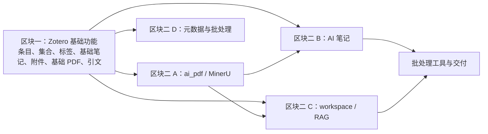

# `zotero-cli` 重构方案

> 状态：区块一与区块二 A/B/C/D 已完成；实际用户数据重建、迁移与清理均未执行。
>
> 审查日期：2026-10-20

## 1. 目标与工作方式

**区块按用户功能划分，不按“纯核心、适配器、服务、CLI”的技术层划分。**区块一直接交付 `zot zotero`：集中 Zotero 接口相关的条目、集合、标签、笔记、附件等基础读写命令。区块二在这些已验证的 Python 能力上，逐项交付 PDF、AI 笔记、workspace 等派生功能。每个区块都同时包含必要的实现、Typer 命令、测试和说明，做完即可局部运行验证。

允许激进替换 Click、旧模块、旧参数及旧兼容格式；不要求保留旧内部 API。**激进不等于丢失数据或弱化安全**：SQLite 只读与 WAL 一致性、Web API 写入、dry-run、显式确认、未知写入结果不得盲重试、配置凭据保护和索引替换时序必须在新架构中重新实现并验证。

实施规则：

- 先在区块一建最小可用的 Typer `zot` 根入口、配置读取、输出和错误处理，再逐类接入 Zotero 基础命令；不预建一个无法用命令验证的完整纯 `core` 层。
- 区块二的功能以 Python 函数或对象复用区块一，不通过 subprocess 调用自身 CLI；按功能实际复杂度增加服务编排，不为每个简单命令强制套多层抽象。
- `.zot/`（仓库根目录）保留为本机配置、缓存、状态和产物容器；源码 `src/zotero_cli/config/` 管理其读取与写入，二者不是同一个目录。该选择延续现有目录语义，不在本轮计划中改为根 `config/`。
- 每个完成的子区块同时替换其旧实现与相关测试、示例；尚未迁移的功能在计划中明确标记为“旧路径待迁移”，不宣称已全部完成，也不长期保留两套相同功能。
- 以下为**方案而非实施授权**；在计划获得确认前，不修改业务源码、不运行迁移、更不删除用户数据。

## 2. 审查依据

### 2.1 当前规模与质量基线

| 项目         | 观察结果                                                     | 含义                                             |
| ------------ | ------------------------------------------------------------ | ------------------------------------------------ |
| 源码规模     | `src/zotero_cli` 含约 80 个 Python 模块                      | 已具备按子域演进的基础                           |
| 测试规模     | 31 个 CLI、42 个单元、6 个集成测试模块                       | 有足够的契约保护，可支持渐进迁移                 |
| 测试结果     | `2374 passed, 26 subtests passed`，耗时 13.69 秒             | 当前行为基线可复现                               |
| Ruff         | `uv run ruff check .` 与 `uv run ruff format --check .` 通过 | 风格门禁已可用                                   |
| mypy         | 103 个错误，均在 `tools/` 的 7 个测试模块                    | 类型检查范围与实际质量目标不一致；不是核心包失败 |
| 依赖可解析性 | Pylance 未发现未解析的顶级导入                               | 无需先处理缺失依赖                               |

本次审查运行的命令：

```text
uv run ruff check .
uv run ruff format --check .
uv run mypy src/zotero_cli tools
uv run pytest -q
```

### 2.2 已验证的架构资产

以下设计应当视为重构约束，而不是待清理的复杂度：

1. `ZoteroReader` 只读访问本地 SQLite，并在存在 WAL 时通过临时副本重放，避免对运行中 Zotero 得到陈旧快照。
2. `ZoteroWriter` 通过 Web API 写入，不能替换为本地数据库写入。
3. `output/envelope.py`、`exit_codes.py`、`streaming.py` 共同维护 AI Agent 可观测契约：单一 JSON envelope、退出码、错误结构和 NDJSON。
4. `cli/safety.py` 是帮助分组与 `zot schema` 共用的安全分级单一来源。
5. RAG 索引需要先完成 MinerU 解析，再变更 SQLite/Qdrant 索引；这项时序保护不能在拆分时丢失。
6. 配置写入必须维持原子写、备份、权限控制与未变更不重写的语义。

### 2.3 与新分区有关的现状

| 现有位置 | 观察 | 新区块归属 |
| --- | --- | --- |
| `commands/items/`、`collections/`、`attachments/attach.py`、`notes/note.py` | Zotero 基础条目、集合、标签、附件与笔记命令当前散落在顶层 | 区块一：`zot zotero ...` |
| `core/zotero/reader.py`、`writer.py` | 本地只读与远程写入实现已存在，读取器约 1,347 行 | 区块一：按读写职责整理，保留安全不变量 |
| `commands/attachments/pdf.py`、`commands/notes/ai_analyze.py` | 读取 Zotero 条目后调用 MinerU 或模型 | 区块二：`ai_pdf` 与 AI 笔记（已迁移） |
| `cli/workspace/`、`workspace/rag/`、`workspace/store.py` | workspace 与索引跨越 CLI、文件、检索实现 | 区块二：workspace 与检索（已迁移） |
| `config/loaders.py`、`output/`、`cli/` | 配置、契约和框架是基础命令运行所需横切能力 | 区块一先完成最小可用部分，后续随功能扩展 |
| `tools/` | 批处理助手包含业务代码和测试 | 本轮保留现状，不迁入 `zot`，也不改动其行为 |

上述为目录与职责观察，不表示所有现有命令都有一一对应的新命令；命令面应在区块一设计时逐项确定。

## 3. 目标架构与功能边界



**这里的区块是交付范围，不是 Python 层。**每个功能区块都包含必要的业务代码、CLI、配置、输出和测试。先让区块一的基本命令可用，再逐个增加派生能力；派生能力调用区块一的 Python 代码，不从 Python 内部调用 `zot` 命令。只有出现真正跨资源编排时才设服务模块；不要预先创建空的 `core/ports/`、`runtime/`、`presentation/` 等抽象目录。

建议的目标目录（只创建已发生的职责）：

```text
src/zotero_cli/
├── cli/
│   ├── app.py               # Typer 根应用、全局参数与统一异常边界
│   ├── output.py            # JSON / 文本与退出码；复杂后再拆分
│   ├── zotero/              # 区块一的子命令：按 item、collection、tag、note、attachment、pdf 组织
│   ├── ai_pdf.py            # 区块二 A：MinerU 解析与缓存读取命令
│   ├── ai_notes.py          # 区块二 B：分析、生成与批量入口
│   └── workspace/           # 区块二 C：workspace / RAG 命令
├── zotero/                  # 区块一：可被派生功能直接复用的 Zotero Python 能力
│   ├── reader.py            # 只读 SQLite、WAL、条目与关联数据读取
│   ├── writer.py            # Web API 写入、冲突与幂等保护
│   ├── items.py             # 搜索、批量水合、条目操作；需要时从 reader.py 拆出
│   ├── collections.py       # 集合、标签、关系与回收站
│   ├── attachments.py       # 本地附件定位、添加、删除与基础关联
│   ├── notes.py             # 基础笔记读写；不包含 AI 生成
│   ├── pdf.py               # 基础 PDF 选择、读取、导出与附加写入；不调用 MinerU
│   ├── citations.py         # BibTeX / CSL-JSON / RIS
│   └── models.py            # Zotero 条目、集合、附件等模型
├── config/                  # 根 `.zot/` 的路径、读取、保存与安全规则
├── ai_pdf/                  # 区块二 A：MinerU 客户端、解析与缓存
├── ai_notes/                # 区块二 B：证据、模型调用、生成与写入编排
├── workspace/               # 区块二 C：工作区清单、索引与检索编排
└── __init__.py

tests/
├── zotero/                  # 区块一：基础能力、命令、安全与输出
├── ai_pdf/                  # 区块二 A
├── ai_notes/                # 区块二 B
├── workspace/               # 区块二 C
└── integration/             # 跨功能区块的端到端验证

.zot/                        # 工作树根目录；不是源码包
├── README.md                # 本机数据边界、隐私与迁移说明
├── config.example.toml      # 无凭据模板，可跟踪
├── config.toml              # 本机配置，忽略
├── cache/                   # MinerU / embedding 等缓存，忽略
├── state/                   # workspace / 幂等状态，忽略
└── output/                  # 导出与批处理产物，忽略
```

`src/zotero_cli/zotero/` 只包含对 Zotero 自身有意义的基础能力，包含基础 PDF 的选择、读取、导出和附件写入；调用 MinerU 解析整篇 PDF、调用外部模型、向量化和跨多条目的流水线放在派生区块。`src/zotero_cli/cli/zotero/` 只解析参数并调用 Python 能力，不重复实现 SQL/API。`.zot/` 继续保留个人配置、缓存、状态与最终产出；本地数据默认不纳入 Git，模板须去除凭据和个人路径。

旧 `commands/`、`core/zotero/` 等模块由对应功能区块逐一替换；未迁移功能暂时标记为“旧路径待迁移”。完成迁移后删除其旧命令、旧实现及无效测试，不建兼容门面。目录图为职责目标，不要求开工时一次性建齐。

## 4. 功能区块与实施顺序

本节起替换已废止的技术分层草案。实施按可交付功能分块，不要求先独立完成一套技术层；每个子区块同时完成 Python 实现、Typer 命令、测试和必要说明。唯一命令入口为 `zot`，不增加独立脚本入口或 `zot runtime` 命令组。

### 4.1 通用交付规则

1. 子区块按“确认命令和数据契约 → 实现 → CLI → 测试与说明 → 局部运行验收 → 退役对应旧路径”完成。不得只迁移命令、不迁移其 Python 能力，或反之。
2. 区块一交付 `zot zotero` 所需的 Typer 根应用、最小配置读取、统一输出和错误处理；这些基础能力与 Zotero 命令同区块完成，不另立技术层区块。
3. 派生功能直接调用区块一的 Python 能力，不从 Python 内部通过 subprocess 调用 `zot`。只在功能确有复杂编排时增加模块或抽象。
4. 未迁移功能标记为“旧路径待迁移”。某功能迁移完成时，同一变更更新其调用方、测试、README、skill 与命令示例，并删除或改写旧命令和实现，不长期双轨运行。
5. 本计划不授权修改用户数据。涉及现有配置、缓存、workspace、manifest、索引或产物的迁移、覆盖、失效和删除，必须先说明影响并取得确认。

### 4.2 区块一：`zot zotero` 基础读写（已完成）

**目标**：在一个可运行的 Typer 命令组中交付所有直接对接 Zotero 的基础条目、集合、标签、附件、PDF、笔记和引文能力。区块内包含最小 `zot` 根入口、`.zot/` 配置读取、输出/错误边界以及基础读写实现；MinerU 解析、模型生成和 workspace/RAG 留给区块二。

建议按以下功能次序迁移，每一项都在此区块内完成实现、CLI、测试和说明：

1. 条目读取与检索：`list`、`read`、`search`、`recent`、`open`、`stats`、`duplicates`、导出和引文。
2. 条目写入：`add`、`update`、标签、关系、删除和回收站操作。
3. 集合与标签管理：读取、创建、移动、重命名、整理和删除。
4. 基础附件、PDF 与笔记：附件定位、添加、删除和关联；PDF 选择、读取、导出与附加写入；基础笔记读写。此处不调用 MinerU，不做 PDF 内容解析或 AI 生成。

### 4.3 区块二：派生功能

每个子区块独立完成自己的 Python 能力、Typer 命令、相关测试和说明；不得把它们推迟到后续统一迁移 CLI。全部命令仍通过 `zot` 入口提供。

#### A：`ai_pdf` / MinerU（已完成）

迁移基于 Zotero PDF 的 MinerU 调用、解析包缓存、结构化内容和结果呈现。基础 PDF 的选择、附件读取与写入已在区块一完成；本子区块只处理外部 AI PDF 解析。建立 `zot ai-pdf ...` 命令，用临时 `.zot/cache/`、假客户端和 fixture PDF 验证；缓存失效或重建若影响现有产物，先确认。为 AI 笔记和 workspace 提供可复用的 Python 解析结果。

#### B：AI 笔记（已完成）

已将 AI 分析、证据构建、模型调用、笔记渲染及通过 Web API 写回迁移至 `ai_notes` 包和 `zot ai-note ...`。测试覆盖预检、模型/网络失败、dry-run、幂等和提交状态；dry-run 不得远程写入，未知写入结果不得盲重试。`summarize` 与 `summarize-all` 不归入本子区块，而是作为 Zotero 元数据功能归入二 D。

#### C：workspace / RAG（已完成）

迁移 workspace 创建、成员管理、导入导出、索引、嵌入和检索查询（建议 `zot workspace ...`），复用区块一读取能力与 A 的 `ai_pdf` 解析结果。索引必须先成功解析并建立替代结果再替换可用索引；只清理本工具创建的数据。既有 workspace manifest、RAG 索引和向量缓存不迁移，按已确认决策失效后重建；实际清理前必须输出受影响路径并取得该次执行的明确确认。

#### D：Zotero 元数据与正式流水线（已完成）

迁移面向 Zotero 元数据的跨条目处理与正式用户流水线（建议 `zot metadata ...`）。`summarize`、`summarize-all` 与 `update-status` 均归入此区块：前两者按新的元数据生成/更新工作流重建，后者默认预览，只有显式 `--apply` 才写入。须覆盖部分成功、幂等、恢复点与未知写入结果。现有 `tools/ainote`、`tools/paper2zotero`、`tools/paperrag` 不属于本轮迁移范围，保留其当前入口、实现和测试，不纳入 `zot metadata` 或其他新命令。

### 4.4 模块与命令归属表

此表用于逐项迁移和追踪，不代表旧接口承诺；命令参数和输出契约在对应子区块开始时由测试明确。

| 当前模块/命令 | 目标归属 | 迁移说明 |
| --- | --- | --- |
| `commands/items/`：条目读写、搜索、统计、重复项 | 区块一 `zot zotero` | 逐命令迁移，完成后退役旧顶层命令 |
| `commands/collections/`、标签和关系命令 | 区块一 `zot zotero` | 随集合/标签功能迁移 |
| `core/zotero/reader.py`、`writer.py` | 区块一 Zotero Python 能力 | 保留 SQLite 只读/WAL 与 Web API 写入边界；按功能整理 |
| `commands/attachments/attach.py`、附件定位 | 区块一 `zot zotero` | 基础附件定位、添加、删除与关联 |
| 基础 PDF 选择、读取、导出与附加写入 | 区块一 `zot zotero pdf ...` | 不调用 MinerU，不进行 AI PDF 内容解析 |
| `commands/notes/note.py` | 区块一基础笔记 | 不含模型生成 |
| `commands/attachments/pdf.py`、MinerU 解析与缓存 | 区块二 A `zot ai-pdf ...` | 仅处理 AI PDF 解析；用户缓存处置需确认 |
| `commands/notes/ai_analyze.py`、AI 生成和写回 | 区块二 B `zot ai-note` / `ai_notes` | 已迁移；保留 dry-run、幂等与提交状态测试 |
| `summarize`、`summarize-all` | 区块二 D `zot metadata ...` | 确认作为 Zotero 元数据生成/更新功能重建 |
| `cli/workspace/`、`workspace/rag/`、`workspace/store.py` | 区块二 C `zot workspace` | 已迁移；替代索引构建成功后才原子替换现有索引；未重建任何用户数据 |
| `update-status` | 区块二 D `zot metadata update-status` | 已迁移；默认预览、显式 `--apply` 写入，并保留部分成功语义 |
| `tools/ainote` | 本轮不处理 | 保留当前入口、实现、测试与本机状态；不迁入 `zot` 命令 |
| `tools/paper2zotero` | 本轮不处理 | 保留当前入口、实现、测试与本机状态；不迁入 `zot` 命令 |
| `tools/paperrag` | 本轮不处理 | 保留当前入口、实现、测试与本机状态；不迁入 workspace/RAG 命令 |
| `config/loaders.py`、`src/zotero_cli/config/` | 区块一最小配置，后续随功能扩展 | 源码负责 `.zot/` 路径、读取与安全写入 |
| `output/`、`cli/`、命令安全分级与 schema | 区块一最小可用能力，后续按需扩展 | 不另设 presentation 或 CLI 迁移区块 |
| `.zot/` 下的配置、缓存、状态和产物 | 本机数据容器 | 默认忽略；模板可跟踪且不得含凭据、个人路径或产物 |

### 4.5 局部验收与旧路径管理

| 子区块 | 局部验收入口 | 重点覆盖 |
| --- | --- | --- |
| 区块一 | `uv run zot zotero -h`、`uv run zot zotero pdf -h`、相关 CLI/单元测试 | Typer 根入口、`.zot/` 最小配置/输出、fixture SQLite、fake Web API、WAL、基础附件/PDF 读写、作用域、确认与幂等 |
| 二 A | `uv run zot ai-pdf -h`、`ai_pdf` / MinerU 单元与集成测试 | MinerU 解析、缓存、超时/失败与产物保护 |
| 二 B | `uv run zot ai-note -h`、AI 笔记及安全测试 | 证据、dry-run、失败恢复、写入状态与未知结果 |
| 二 C | `uv run zot workspace -h`、workspace/RAG 测试 | 导入导出、索引替换时序、部分失败、重建清单和用户数据保护 |
| 二 D | `uv run zot metadata -h`、元数据与正式流水线测试 | summarize/update-status、预览/应用、失败清单、幂等、恢复点和输出位置 |

每个子区块还须运行对应 Ruff 检查和格式检查；整轮功能迁移完成后运行全量测试、构建和 `uv run zot --help`。类型检查如实区分源码与工具的结果，不将既有 tools 测试错误描述为核心源码通过或失败。

旧路径只按功能退役：未迁移项明确标记“旧路径待迁移”；完成迁移项更新所有内部调用方、测试和文档，并移除已被替代的命令注册、实现和过时示例。不得新增兼容包装、旧命令别名或第二套运行路径。既有 workspace manifest、RAG 索引、MinerU 缓存及相关本机派生产物按已确认策略重建，不迁移旧格式；每次实际清理仍须展示影响并取得明确确认。

## 5. 隐私、数据与安全边界

| 范围 | 实施要求 |
| --- | --- |
| Zotero 数据库 | 只读；存在 WAL 时以副本重放取得一致快照；本地 SQL 不承担写入 |
| 远程写入 | 只经 Web API；保留 dry-run、明确确认、非交互安全失败、幂等与未知结果不盲重试 |
| 输出 | JSON stdout 维持单一 envelope；进度和告警走 stderr；流事件与退出码有测试 |
| 凭据与配置 | 不读取、展示或提交真实凭据；保留原子写、权限、备份和凭据脱敏 |
| 用户数据 | 不擅自覆盖、迁移、失效或删除配置、缓存、workspace、manifest、索引和产物 |
| 索引与缓存 | 替代数据成功前保留可用索引；只清理本工具拥有的数据；重建前说明影响并确认 |
| `.gitignore` | 作为用户维护文件保持不变；按现有规则保护本机数据，不因本计划改写 |

## 6. 已确认的开工决策

1. `summarize` 与 `summarize-all` 并入二 D，作为 Zotero 元数据生成与更新功能重建。
2. `update-status` 放入二 D；默认仅预览，显式 `--apply` 才可写入。
3. `tools/ainote`、`tools/paper2zotero`、`tools/paperrag` 本轮不处理：保留当前入口、实现、测试和本机状态，不迁入新的 `zot` 命令。
4. 既有 workspace manifest、RAG 索引、MinerU 缓存及相关派生产物采用重建策略，不迁移旧格式。配置保留在 `.zot/`，实际调整配置或清理重建数据前仍须展示影响并取得该次执行的明确确认。

上述决策确定了本轮功能归属与数据处置方向，但本计划本身不授权立即删除、覆盖或重建用户数据；实际实施到相应步骤时必须再次展示具体路径、影响和恢复方式。
